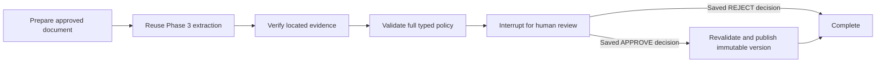

# Checkpointed policy workflows

The API owns a typed `StateGraph` with seven explicit nodes:

`app/agents/graph.py` orchestrates existing services. Extraction calls Phase 3 `process_document`; it does not implement a second parser or Gemini mapper. Candidate findings and edits are distinct from executable rules. The state contains document/job/review identifiers and policy proposals, never applicant profiles or credentials. Source text remains untrusted data.

Each workflow UUID is its stable LangGraph `thread_id`. Official `AsyncPostgresSaver` writes sync-durability checkpoints to the separate `sg_checkpoints` schema. Alembic owns the saver schema and its ten current SDK migrations; runtime startup does not execute SDK DDL. Serializer pickle fallback is disabled and deserialization permits only LangGraph Interrupt/Send types. Changing checkpoint SDK versions requires inspecting their migrations and compatibility before upgrading locks.

The workflow uses current `interrupt(..., response_schema=ReviewResume)` and `Command(resume=...)`. An interrupt releases request resources; no open business transaction waits for a human. Resume accepts only a decision already stored by an authenticated administrator. The API never accepts arbitrary LangGraph state or a client-supplied approval command.

## Recovery and idempotence

- Creation requires a caller-generated UUID `request_key`, unique per requesting administrator; a fingerprint prevents reusing the key for a different document or extraction. Repeat the same request to retrieve its saved workflow.
- A dedicated PostgreSQL advisory transaction lock prevents simultaneous execution, approval/resume, or cancellation of the same workflow. A dead API process releases that lock automatically.
- Workflow stages and events are persisted. Node re-entry reuses stable job, review, revision and publication identifiers. A completed extraction is reused, avoiding a duplicate paid model call after checkpoint replay. An explicit retry after a failed extraction uses a new attempt ID and preserves failed history.
- Transient database failures in verification/schema validation retry at most twice. Gemini has the existing bounded timeout/retry policy. The whole invocation has `WORKFLOW_TIMEOUT` (default 150 seconds, maximum 300). Explicit workflow attempts are capped by `WORKFLOW_MAX_ATTEMPTS` (default 3).
- An exception records a safe error code and exception class in history; source text, credentials and raw provider errors are not logged. A failed invocation retains checkpoints for operator-requested resume. An approved decision remains immutable if publication fails; retry cannot silently edit that decision. A changed policy/overlap requiring different review needs a new workflow.
- Publication locks the scheme row, checks the unique publication ledger first, then creates the next RuleSet number. Draft parent, conditions, evidence, approval metadata, ledger and workflow binding commit atomically. Existing approved versions stay intact. A replay returns that publication instead of creating another.
- Cancel is allowed only while undecided and unpublished, and only when the execution lock is free. Cancellation preserves all extraction, review and checkpoint history. Cancelled workflows cannot resume.

## Operations

Start from `/admin/documents/{id}`. Choose a new Gemini extraction or explicitly reuse a successful extraction from that exact document. Provider labels remain visible, including mocked/fixture jobs. The workflow list and pending review queue are available at `/admin/workflows` and `/admin/reviews`. Workflow details expose stage, attempt count, history and safe errors. Refresh status after a browser timeout before retrying the same request key.

Processing is bounded **synchronous request execution**, using async I/O and the existing bounded PDF subprocess; no Celery, Redis or unattended scheduler is introduced. A two-operation semaphore bounds local document work. For larger workloads a future worker can invoke the same runner with the same durable IDs. HTTP request execution is not a background-job guarantee: an operator must resume a workflow left PROCESSING after a process crash. Container restart preserves state, but does not automatically run pending work.

Tracing is disabled in Compose (`LANGSMITH_TRACING=false`, `LANGSMITH_TRACING_V2=false`); no external tracing account is required.
